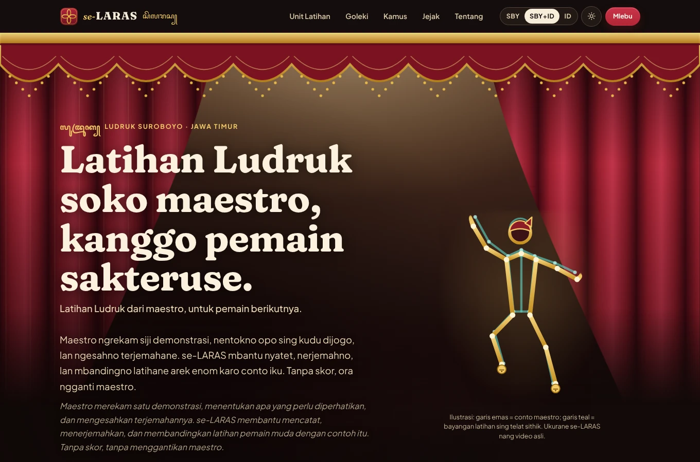
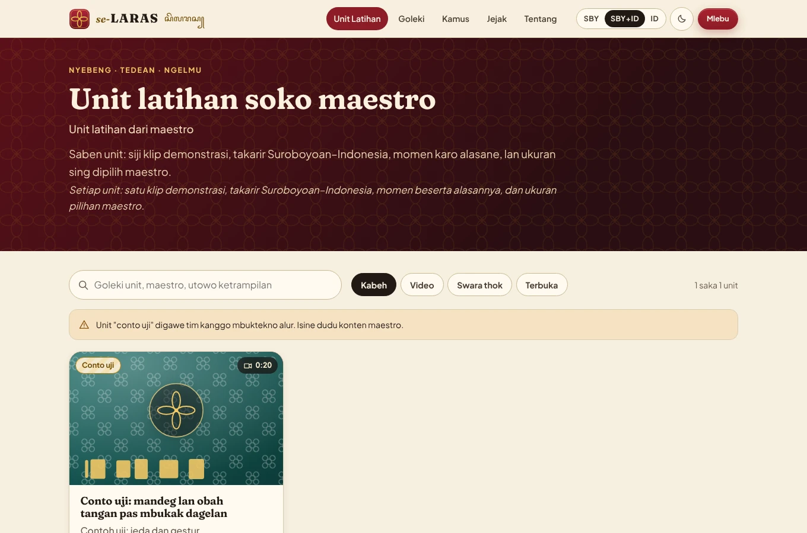
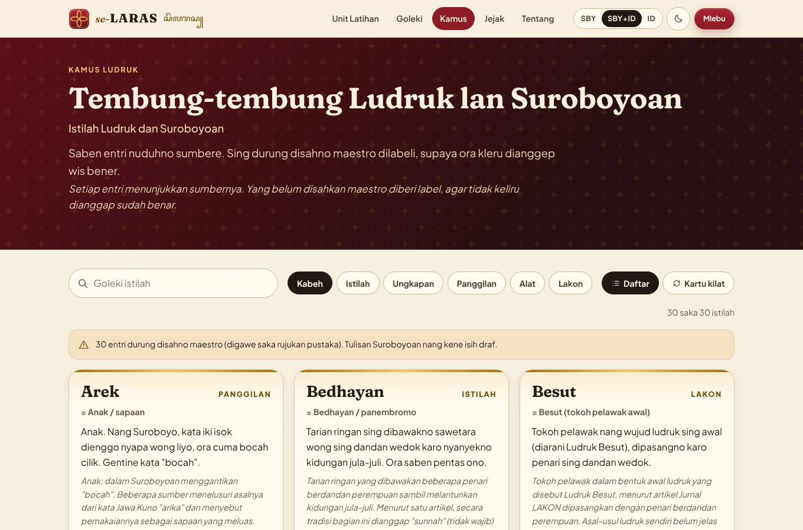
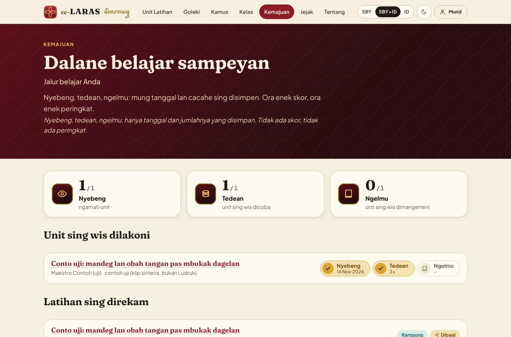

# se-LARAS

**L**iving **A**rts **R**epository, **A**nalysis, and **S**kills-transfer: arsip belajar Ludruk Surabaya yang disusun **maestro**,
dipakai pemain berikutnya untuk berlatih, dengan analisis deskriptif berbantuan AI dan antarmuka berbahasa Suroboyoan.

BUDAYA GO! 2026 · Inovasi Digital · Subtema 4 (Pembelajaran dan Edukasi Digital Berbasis Budaya).
Versi 0.3.0. **Tanggal pembuatan sebenarnya: 2026-11-14** (modul akun/unggah berizin/buku jejak dipakai ulang dari LudrukHub, dibuat 2026-11-12). Produk ini **tidak ada sebelum 31 Maret 2026**; lihat `docs/DAFTAR_VERIFIKASI.md` butir 1.

> "selaras" = serasi, sejalan. "laras" = sistem penalaan gamelan (slendro/pelog). Makna dan penulisan aksara `ꦱꦼꦭꦫꦱ꧀` **perlu diverifikasi** penutur/ahli aksara.

## Tampilan

Gambar diambil dari aplikasi yang sedang berjalan (`python3 e2e/capture_media.py`). **Isinya data contoh sintetis**: penari kartun buatan tim dan suara LJSpeech. Ini bukan rekaman Ludruk; tidak ada maestro atau pelajar sungguhan, dan teks Suroboyoan masih draf.

<table>
<tr>
<td></td>
<td></td>
</tr>
<tr>
<td></td>
<td></td>
</tr>
</table>

Halaman penuh: [beranda](docs/img/01-beranda.webp) · [unit, pemutar, transkrip](docs/img/04-unit-detail.webp) · [hasil perbandingan](docs/img/05-hasil-perbandingan.webp) · [studio latihan](docs/img/06-studio-latihan.webp) · [ruang maestro](docs/img/09-maestro-kelola.webp) · [buku jejak](docs/img/10-jejak.webp) · [tentang](docs/img/11-tentang.webp). Ponsel: [beranda](docs/img/m1-beranda.webp) · [unit](docs/img/m2-unit-detail.webp) · [hasil, tema gelap](docs/img/m3-hasil-gelap.webp).

Video penelusuran 115 detik (keterangan "data contoh sintetis" tampil di setiap bingkai): [`docs/media/penelusuran-se-laras.mp4`](docs/media/penelusuran-se-laras.mp4). Ini draf: **ganti dengan rekaman tim sendiri** (klip dan izin milik tim) sebelum dipakai di luar tim.

## Apa yang ada, apa yang tidak

| Ada dan sudah dijalankan | Belum ada / tidak diklaim |
|---|---|
| Alur lengkap maestro: unggah berizin → analisis klip (suara + gerak) → transkrip Suroboyoan–Indonesia → momen "kenapa" → ukuran pilihan maestro + toleransi → pengesahan | **Tidak ada maestro nyata** dan tidak ada klip Ludruk nyata. Unit "contoh uji" memakai klip sintetis dan diberi label di setiap layar |
| Pelajar: lihat unit (takarir, momen, kerangka gerak), rekam/unggah latihan dengan persetujuan per klip, lihat selisih deskriptif terhadap acuan maestro (tanpa skor gabungan) | **Tidak ada model ASR/AI yang dilatih pada data Ludruk.** Tidak ada korpus Ludruk/Suroboyoan publik yang ditemukan; lihat `docs/DATASET_DAN_PELATIHAN.md` |
| Kamus 30 entri bersumber (status *draf* sampai disahkan maestro), pencarian bersumber, kelas + kode gabung, ruang admin, buku jejak berantai-hash | Akurasi pose/jeda **pada rekaman panggung Ludruk belum pernah diukur**. Evaluasi hanya pada data publik non-Ludruk (`docs/EVALUASI.md`) |
| 46 tes Node, 73 tes Python (10 di antaranya dilewati bila data uji publik belum diunduh), uji e2e (alur maestro, alur pelajar via kamera palsu, 72 pemeriksaan halaman; axe-core 4.14.0 nol pelanggaran). Rincian dan batasnya: `docs/PENGUJIAN.md` | Teks Suroboyoan di antarmuka dan definisi kamus adalah **draf** menunggu penutur asli |
| Dockerfile, docker-compose, CI GitHub Actions, Makefile | `docker build` dan CI GitHub Actions **belum pernah dijalankan** (tidak ada daemon Docker dan belum ada repositori git di lingkungan pengembangan) |

## Jalan cepat

Butuh Node ≥ 22 (diuji 22.23), Python 3.13, `ffmpeg` + `ffprobe`. **Diuji hanya di Linux x64** (Ubuntu 24.04). Windows dan macOS belum dicoba; di Windows, jalankan di dalam WSL2 (Ubuntu), yang juga belum dicoba.

```bash
npm ci
python3 -m pip install -r analyzer/requirements.txt
python3 analyzer/evaluation/fetch_data.py       # data uji publik (sha256 diperiksa); tanpa ini 10 tes Python dilewati
export SESSION_SECRET=$(openssl rand -hex 24)   # tetap! dipakai untuk sesi DAN tanda buku jejak
npm run seed                                    # opsional: 1 unit contoh (klip sintetis, BUKAN Ludruk) + 3 akun contoh
LARAS_DEMO=1 npm start                          # http://localhost:3000 (LARAS_DEMO=1 hanya menampilkan tombol masuk akun contoh)
```

`.npmrc` mematikan skrip pasang npm. Sebabnya: better-sqlite3 13 membawa biner siap pakai (Linux x64/arm64 baik glibc maupun musl, macOS x64/arm64, Windows x64/arm64), tetapi `npm ci` dari `package-lock.json` tetap menjalankan `node-gyp rebuild` (teramati dengan npm 10.9.9), yang butuh kompilator C++ dan unduhan dari nodejs.org. Platform di luar daftar biner itu tidak didukung paketnya.

Akun contoh (setelah `npm run seed`): `murid-contoh@`, `maestro-contoh@`, `admin-contoh@laras.invalid`, kata sandi `contoh-uji-123`. **Jangan** pakai di produksi.
Untuk akun nyata: isi `ADMIN_EMAILS`, daftar lewat antarmuka, lalu admin memberi peran maestro (menu Admin).

Docker (belum teruji build, lihat catatan di `Dockerfile`):

```bash
cp .env.example .env     # isi SESSION_SECRET
docker compose up --build
```

## Perintah

| Perintah | Fungsi |
|---|---|
| `npm test` | 46 tes Node (izin, gerbang pengesahan, privasi, pembersihan, buku jejak, pemulihan pekerjaan, perbandingan, glosarium, pipa dataset, satu uji dengan analyzer Python nyata, konsistensi pemasangan) |
| `npm run test:py` | 73 tes Python (VAD, jeda, DTW dan rasio tempo, deteksi orang/momen, kalibrasi, keutuhan model, penukar manifest → ASR, WER/CER dan pembagi data) |
| `npm run check:ui` | sintaks 44 modul frontend sebagai ES module |
| `npm run e2e` | uji ujung-ke-ujung Playwright pada server sementara (`pip install -r analyzer/requirements-dev.txt && python3 -m playwright install chromium`) |
| `npm run test:all` | `check:ui` + Node + Python |
| `npm run eval` | ulangi evaluasi analyzer pada data uji publik (`analyzer/evaluation/fetch_data.py` mengunduhnya, diverifikasi sha256) |
| `npm run export-dataset` | ekspor korpus riset: hanya unit sah + `data_use=riset` + bukan contoh + hash cocok |
| `python3 analyzer/manifest_to_asr.py …`, `make_splits.py`, `asr_eval.py` | manifest → ujaran 16 kHz (`--speaker-map` untuk penutur sebenarnya), pembagian menurut penutur (menolak < 5 penutur), WER/CER; lihat `docs/DATASET_DAN_PELATIHAN.md` |
| `python3 analyzer/verify_models.py` | cocokkan sha256 ketiga model dengan `analyzer/models/MODELS.json` (`--online` mengunduh ulang) |
| `python3 seed/fixtures/make_fixtures.py` | buat ulang dua klip contoh (penari kartun buatan tim + suara LJSpeech) |
| `python3 e2e/capture_media.py [--shots] [--video] [--png]` | ambil ulang tangkapan layar (`docs/img/`, WebP; `--png` untuk slide/dokumen) dan video penelusuran (`docs/media/`) dari aplikasi yang berjalan. Butuh Playwright, Pillow, ffmpeg |
| `python3 scripts/package.py [--verify]` | zip rilis `../dist/se-LARAS-v<versi>.zip` (tanpa `node_modules`, `data`, data uji publik, cache, `.env`). `--verify` mengekstraknya ke direktori **baru** lalu menjalankan `npm ci`, `check:ui`, `npm test`, dan `verify_models.py` di sana |
| `make …` | jalan pintas untuk perintah di atas; lihat `Makefile` |

## Konfigurasi (variabel lingkungan)

| Variabel | Arti |
|---|---|
| `SESSION_SECRET` | **wajib** di produksi (≥ 16 karakter). Mengganti nilainya membuat tanda buku jejak lama tak terverifikasi |
| `ADMIN_EMAILS` | email (koma) yang otomatis admin saat mendaftar |
| `PORT`, `DATA_DIR` | port (3000) dan lokasi basis data + unggahan (`./data`; Docker: `/data`) |
| `SECURE_COOKIES=1` | bila disajikan lewat HTTPS |
| `ANTHROPIC_API_KEY`, `AI_MODEL` | opsional: usulan segmen teks. Tanpa kunci fitur nonaktif (tidak dipalsukan). Langganan Claude Pro bukan kunci API |
| `ASR_COMMAND_JSON` | opsional: perintah pengenal ujaran milik operator; hasilnya hanya draf |
| `AUTH_LIMIT` | batas percobaan masuk per jendela waktu (10) |
| `LARAS_DEMO=1` | hanya demo lokal |
| `PYTHON`, `FFMPEG`, `FFPROBE` | lokasi biner bila bukan bawaan |

## Isi repositori

```
src/        server Express 5 + SQLite (better-sqlite3, FTS5), buku jejak, metrik, ekspor data
public/     SPA tanpa kerangka kerja: modul ES, tanpa innerHTML, CSP ketat; font dihosting sendiri
analyzer/   mesin analisis Python: Silero VAD, YOLOX-S, BlazePose, DTW; evaluasi + kalibrasi + alat data
seed/       glosarium bersumber (30 entri) dan klip contoh sintetis
e2e/        uji ujung-ke-ujung Playwright      scripts/  ekspor dataset, cek frontend, pengemasan zip
docs/       arsitektur, dataset & pelatihan, evaluasi, protokol data, sumber, panduan desain, daftar verifikasi;
            img/ tangkapan layar, media/ video penelusuran (keduanya berisi DATA CONTOH SINTETIS)
```

## Asal kode dan lisensi (juknis F.2)

- **LudrukHub** (tim yang sama, 2026-11-12): akun dan peran, unggah berizin, buku jejak berantai-hash. Dibawa ke se-LARAS pada 2026-11-14.
- **Model** (`analyzer/models/`, teks lisensi di samping modelnya): BlazePose GHUM full (MediaPipe, Apache-2.0), Silero VAD v6.2 (MIT), YOLOX-S (Apache-2.0).
- **Font** dihosting sendiri, SIL OFL 1.1 (`public/fonts/LISENSI.txt`): Fraunces, Plus Jakarta Sans, Noto Sans Javanese.
- **Ilustrasi** (penari kerangka, siluet gamelan, ornamen kawung/parang/ceplok/truntum) digambar ulang sebagai SVG asli; **tidak ada foto internet yang dibundel**.
- **Klip contoh** (`seed/fixtures`): suara LJSpeech `LJ001-0001` (dinyatakan domain publik di AS oleh pengumpulnya) + **penari kartun yang digambar dengan kode oleh tim** (`seed/fixtures/make_fixtures.py`); tidak ada foto atau rekaman orang. Status hak cipta suara itu tetap **perlu diverifikasi** sebelum didistribusikan di luar repositori.
- Pustaka pihak ketiga mengikuti lisensi paket masing-masing; daftar lengkap belum dikompilasi (lihat `docs/DAFTAR_VERIFIKASI.md`).

## Data pribadi

Klip pelajar = wajah, tubuh, suara. Persetujuan per klip; diproses di server sendiri tanpa layanan luar; dapat dihapus kapan saja; terhapus otomatis setelah 30 hari; hanya terlihat pemilik kecuali dibagikan ke maestro unit itu. Rekaman pelajar **tidak pernah** masuk ekspor riset. **Batas yang diketahui:** buku jejak berantai-hash memuat nama pemberi izin klip maestro dan tidak bisa dihapus per entri (`docs/DAFTAR_VERIFIKASI.md` A5). Penerapan UU PDP pada titik kunci pose dan suara serta hak atas ekspresi budaya tradisional **perlu dipastikan dengan penasihat hukum**.

## Dokumen

`docs/ARSITEKTUR.md` · `docs/DATASET_DAN_PELATIHAN.md` · `docs/EVALUASI.md` · `docs/PROTOKOL_PENGUMPULAN_DATA.md` · `docs/PENGUJIAN.md` · `docs/SUMBER.md` · `docs/PANDUAN_DESAIN.md` · `docs/DAFTAR_VERIFIKASI.md`
