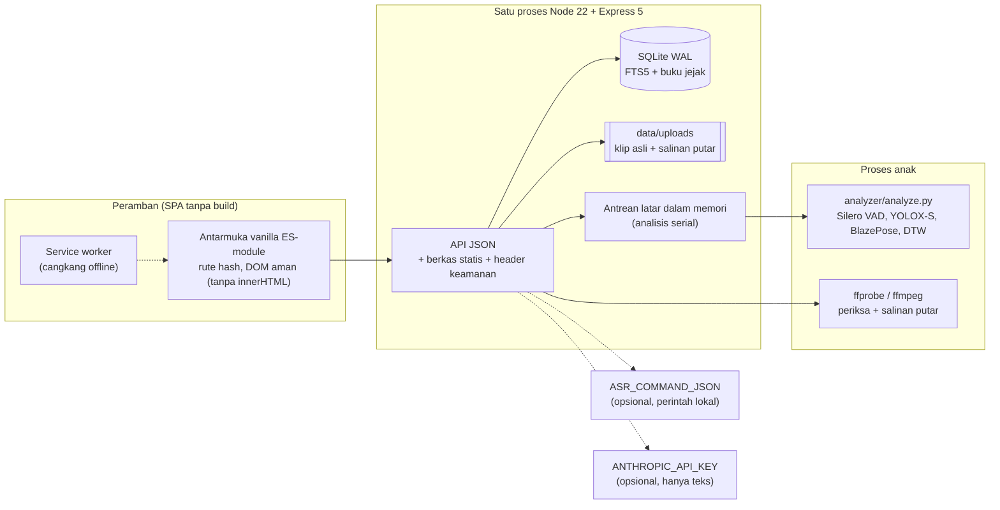

# Arsitektur se-LARAS

Dokumen ini menjelaskan bagaimana sistem tersusun, aturan apa yang **ditegakkan server** (bukan sekadar disembunyikan di antarmuka), dan di mana batasnya. Semua pernyataan di sini bisa dicocokkan dengan kode; nama tes yang menjaganya ditulis di tabel gerbang. Hal yang belum terbukti ditandai **Perlu verifikasi** atau dicantumkan di bagian *Batas yang diketahui*.

Versi aplikasi: `0.3.0` (`src/app.js`). Build pertama se-LARAS: **2026-11-14**. Modul akun/peran, arsip klip berizin, dan buku jejak berantai dipakai ulang dari LudrukHub (dibangun 2026-11-12); `/api/about` menyatakan hal ini terbuka.

---

## 1. Gambaran

- **Tidak ada layanan luar yang wajib.** Analisis suara dan gerak berjalan di server sendiri (CPU). Dua integrasi opsional dimatikan secara bawaan: perintah ASR lokal (`ASR_COMMAND_JSON`) dan model bahasa untuk usulan teks (`ANTHROPIC_API_KEY`); keduanya hanya menghasilkan **draf** yang menunggu pengesahan maestro.
- **Tidak ada langkah build frontend.** `public/` dilayani apa adanya. `npm run check:ui` memeriksa sintaks semua modul ES dan **melarang** pola yang melanggar kebijakan DOM aman/CSP: `innerHTML`/`outerHTML`, `insertAdjacentHTML`, `document.write`, `eval`, `new Function`, `setAttribute('style'|'on*')`, serta atribut `style`/`on*` dan `<script>` inline di `index.html`. (Impor yang salah tertangkap oleh suite e2e, yang gagal bila ada galat konsol saat memuat halaman.)
- **Satu proses, satu berkas basis data.** Sederhana untuk dijalankan di server kecil; konsekuensinya ada di bagian 9.

## 2. Komponen dan berkas

| Lapisan | Berkas | Tugas |
|---|---|---|
| Server | `src/server.js` | Menyalakan aplikasi: membaca env, memeriksa ffmpeg, membuka DB, memuat glosarium bawaan, memulihkan pekerjaan yang tertinggal, membersihkan latihan lama berkala, berhenti dengan rapi (SIGINT/SIGTERM) |
| | `src/app.js` | Pabrik aplikasi (`createApp`): header keamanan, auth, unit, segmen, rubrik, momen, latihan, pencarian, buku jejak, penghapusan |
| | `src/routes/*.js` | `admin` (ringkasan, korpus, kartu data), `captions` (WebVTT), `classes`, `glossary`, `markers`, `persons` (pilih penampil), `progress` |
| | `src/db.js` | Skema, migrasi lewat `PRAGMA user_version` (versi skema 2), indeks pencarian |
| | `src/ledger.js` | Buku jejak berantai-hash + tanda HMAC |
| | `src/metrics.js` | Katalog ukuran, lantai kebisingan dari `calibration.json`, perbandingan deskriptif |
| | `src/media.js` | `ffprobe` (validasi, durasi, aliran) dan `ffmpeg` (salinan putar ramah-peramban, bingkai JPEG) |
| | `src/analysis.js` | Menjalankan analyzer Python **satu per satu** lewat rantai Promise |
| | `src/asr.js`, `src/ai.js` | Integrasi opsional (lihat di atas) |
| | `src/dataset.js` | Manifest korpus riset + kartu data; ekspor |
| | `src/seed.js` | Data peragaan berlabel "contoh" (hanya bila `LARAS_DEMO=1`) |
| Analyzer | `analyzer/analyze.py` | Titik masuk: mode `both` / `audio` / `video`, opsi `--track`, `--ref` |
| | `audiocore.py`, `vad.py` | Jeda, tempo, nada, energi; Silero VAD v6.2 (ONNX) dengan normalisasi level sebelum VAD |
| | `detect.py`, `posecore.py` | YOLOX-S + pelacak IoU; BlazePose GHUM *full* (TFLite) |
| | `align.py` | Penyejajaran waktu (DTW pada MFCC), penilaian keandalan (ambang biaya 0,58), dan rasio tempo dari **kemiringan lintasan DTW bagian dalam** (tepi 15% dibuang; rasio durasi ucapan lama disimpan hanya sebagai pembanding) |
| | `moments.py` | Usulan momen otomatis (selalu berstatus `draft_ai`) |
| | `asr_eval.py`, `make_splits.py`, `evaluate.py` | Penghitung WER/CER, pembagi latih/uji menurut penutur, harness evaluasi |
| Frontend | `public/js/main.js` | Cangkang: rute, bilah atas adaptif, tema, bahasa |
| | `public/js/pages/*`, `public/js/comp/*`, `public/js/art/*` | Halaman, komponen (pemutar, dst.), ilustrasi SVG orisinal |
| | `public/css/*.css` | Token desain, komponen, halaman ("Panggung se-LARAS") |
| Operasi | `Dockerfile`, `docker-compose.yml`, `Makefile`, `.github/workflows/ci.yml` | Lihat bagian 8 |
| Uji | `test/*.test.js`, `analyzer/tests/*`, `e2e/*` | Lihat `docs/PENGUJIAN.md` |

## 3. Peran dan hak

| Peran | Didapat dari | Boleh |
|---|---|---|
| Pelajar (`learner`) | Mendaftar (wajib menyetujui pemrosesan data pribadi) | Melihat unit sah, mencari, berlatih (rekaman diri), mengikuti kelas, mencatat kemajuan, menghapus rekamannya/akunnya |
| Maestro / praktisi (`maestro`) | Diberi oleh admin; tidak ada pendaftaran sendiri sebagai maestro | Semua hak pelajar + mengunggah klip, menyunting/mengesahkan transkrip, momen, rubrik, glosarium, membuat kelas |
| Admin (`admin`) | Alamat email di `ADMIN_EMAILS` saat mendaftar | Semua hak maestro + mengubah peran, melihat ringkasan, korpus riset, buku jejak lengkap |

Peran dibaca ulang dari basis data pada **setiap permintaan** (`userById`), sehingga penurunan peran atau penghapusan akun berlaku seketika walau token masih ada.

## 4. Alur utama

### 4.1 Maestro: dari klip ke pengetahuan yang disahkan

1. **Unggah** (`POST /api/units`): wajib klip, nama pemberi izin, tanggal izin (tidak boleh di masa depan), dan centang persetujuan. Berkas disimpan dengan nama acak; `ffprobe` memastikan benar-benar media, mengambil durasi (maksimal 150 dtk) dan jenis aliran; berkas yang bukan media dibuang dan ditolak 400.
2. **Buku jejak**: entri `unit_dibuat` mencatat hash SHA-256 klip asli, pemberi izin, tanggal, lingkup, dan tujuan data.
3. **Latar belakang**: analisis (suara + gerak) dan salinan putar (H.264/AAC bila aslinya belum ramah-peramban). Klip asli tidak diubah dan tetap sumber analisis; hash asli dan salinan dicatat (`salinan_putar_dibuat`).
4. **Usulan momen otomatis** (`jeda`/`gerak`) masuk sebagai `draft_ai` dan tersembunyi dari pelajar; yang sudah disentuh/disahkan maestro tidak ditimpa.
5. **Pekerjaan maestro**: transkrip Suroboyoan + terjemahan Indonesia, momen berpenjelasan "kenapa", rubrik (ukuran yang bermakna menurut maestro, nama, petunjuk, toleransi), pemilihan penampil utama bila video memuat banyak orang.
6. **Pengesahan** (`POST /api/units/:id/validate`) lewat gerbang `readiness()` (bagian 5). Hanya setelah lolos, unit `validated`, diindeks untuk pencarian, dan terlihat pelajar.
7. **Perubahan setelah sah** (menyunting segmen/momen) mengembalikan unit ke `draft` (`unit_dibuka_kembali`).
8. **Penarikan** (`withdraw`): berkas klip dan salinan dihapus, analisis dikosongkan, indeks pencarian dibuang; jejaknya tetap (`unit_ditarik`).

### 4.2 Pelajar: berlatih dengan perbandingan deskriptif

1. Pelajar memilih unit sah, merekam/menunggah klip dirinya, **wajib** mencentang persetujuan pemrosesan suara dan video dirinya. Pilihan "bagikan ke maestro" mati secara bawaan.
2. Entri `persetujuan_latihan` mencatat hash klip, ada/tidaknya berbagi, dan masa simpan.
3. Analisis berjalan dengan klip maestro sebagai acuan (`--ref`) untuk penyejajaran DTW. `metrics.compare` membandingkan **hanya ukuran yang dipilih maestro**: selisih terhadap acuan, dengan toleransi maestro dan lantai kebisingan terukur. **Tidak ada skor gabungan dan tidak ada "benar/salah"**. Ukuran yang tidak andal pada rekaman itu (derau, audio tak memadai, pose sulit dideteksi) ditandai tidak andal beserta alasannya, bukan diberi angka.
4. Rekaman terlihat hanya oleh pemiliknya, dan oleh maestro pemilik unit **bila** pelajar membagikannya (dapat dicabut). Pelajar dapat menghapusnya kapan saja; semuanya otomatis terhapus setelah **30 hari** (`ATTEMPT_TTL_DAYS`), atau bersama akunnya.
5. Catatan kemajuan belajar (tanggal dan hitungan: *nyebeng*, *tedean*, *ngelmu*) bertahan setelah rekaman dihapus dan dihapus bersama akun.

### 4.3 Pencarian bersumber (retrieval-first)

`GET /api/search` mencari di indeks FTS5 yang **hanya** memuat segmen dan momen yang disahkan dari unit yang sah. Hasilnya berupa kutipan berlabel sumber (maestro, judul unit, menit); **tidak ada jawaban yang dibangkitkan model**, sehingga tidak ada halusinasi karena memang tidak ada generasi.

## 5. Gerbang yang ditegakkan server

Ini aturan yang tidak bisa dilewati dengan memanggil API langsung. Kolom terakhir adalah tes yang menjaganya (`test/app.test.js` dan `test/v2.test.js`, kecuali disebut lain).

| Aturan | Ditegakkan di | Tes |
|---|---|---|
| Klip, nama pemberi izin, dan tanggal izin (bukan masa depan) wajib untuk unit | `POST /api/units` | "unit: wajib klip, izin tertulis, dan tanggal izin tidak di masa depan" |
| Pengesahan butuh: analisis selesai, ≥1 ukuran rubrik yang tersedia/andal pada klip acuan, ≥1 segmen sah, dan penampil utama bila ≥2 orang terdeteksi | `readiness()` → `validate` | "pengesahan unit digerbangi: analisis, rubrik, dan segmen sah" |
| Pelajar hanya melihat unit sah, dan hanya segmen/momen sah | `GET /api/units`, `/:id`, captions, search | "unit sah terlihat pelajar; hanya segmen sah yang muncul…", "usulan momen…tersembunyi dari pelajar", "takarir WebVTT…" |
| Mengubah isi unit sah membukanya kembali | `reopen()` | "…ubah segmen membuka kembali unit", "momen: sunting mengembalikan ke draf…" |
| Persetujuan pelajar wajib untuk rekaman dirinya; hanya pemilik (dan maestro bila dibagikan) yang melihat | `POST /api/units/:id/attempts`, `canSeeAttempt` | "latihan pelajar: persetujuan wajib, perbandingan deskriptif tanpa skor, privasi" |
| Rekaman buruk menghasilkan penanda tidak andal, bukan angka karangan | `metrics.reliability` | "rekaman buruk: ukuran ditandai tidak andal, bukan angka karangan" |
| Analisis yang gagal dicatat gagal; server tetap hidup | `schedule()` | "analisis gagal dicatat sebagai gagal, server tetap hidup" |
| Pekerjaan latar yang tertinggal saat server mati dijadwalkan ulang | `recoverJobs()` | `test/recovery.test.js` (3 tes) |
| Latihan otomatis terhapus setelah 30 hari | `purgeOld()` | "pembersihan otomatis…" |
| Hapus akun menghapus latihan, klip asli, dan salinan putar | `DELETE /api/me` | "hapus akun menghapus latihan dan berkasnya", "hapus akun: berkas asli dan salinan putar semua terhapus…" |
| Tarik unit menghapus klip, analisis, indeks | `withdraw` | "tarik unit menghapus klip, analisis, dan indeks pencarian" |
| Entri glosarium bersumber tampil berlabel; draf maestro tersembunyi sampai disahkan; entri tanpa sumber tidak dimuat | `routes/glossary.js` | "glosarium: entri pustaka tampil berlabel…", `test/glossary-seed.test.js` |
| Korpus riset: hanya klip sah + `data_use='riset'` + bukan contoh + berkas ada + hash cocok; latihan pelajar tidak pernah ikut | `src/dataset.js` | "admin: ringkasan hanya untuk admin; korpus riset hanya klip sah+izin riset…" |
| Asal (Origin) asing ditolak untuk permintaan pengubah data | middleware | "keamanan: Origin asing ditolak…" |
| Peran maestro hanya diberi admin | `PATCH /api/users/:id/role` | "daftar wajib persetujuan; peran maestro hanya diberi admin" |
| ASR dan AI opsional: tanpa konfigurasi ditolak dengan jelas; hasilnya berstatus draf | `asr.js`, `ai.js` | "ASR opsional…", "AI teks opsional…" |

## 6. Model data

SQLite, mode WAL, kunci asing aktif. Migrasi berjalan otomatis saat membuka berkas (`PRAGMA user_version`); tes `migrasi:` memeriksa basis data baru **dan** peningkatan dari v0.1 yang mempertahankan data.

| Tabel | Isi |
|---|---|
| `users`, `maestro_profiles` | Akun, peran, waktu persetujuan; profil maestro (sanggar, wilayah, bio) |
| `units` | Unit latihan: judul (Suroboyoan/Indonesia), berkas, izin (`consent_*`, `data_use`), `analysis` (JSON), `analysis_status`, `media_status`, `performer_track`, `status` (`draft`/`validated`/`withdrawn`), `orig_sha256` |
| `segments` | Transkrip bertimestamp (`draft_ai`/`draft_human`/`validated`; `source`: `manual`, `ai`, atau `asr`) |
| `markers` | Momen: `jeda`/`gerak`/`lain`, judul, "kenapa" maestro, status, `source` (`ai`/`manual`) |
| `rubric_dims` | Ukuran yang dipilih maestro per unit: `metric`, label (dua bahasa), petunjuk, `tolerance_pct` (5–100) |
| `attempts` | Latihan pelajar: berkas, `share_with_maestro`, `analysis`, `comparison`, `status`, `self_note` |
| `ledger` | Buku jejak berantai-hash (bagian 7) |
| `classes`, `class_members`, `class_units` | Kelas: kode gabung, anggota, unit yang ditugaskan |
| `glossary` | Istilah Ludruk/Suroboyoan: `basis` (`pustaka`/`maestro`), `status` (`draft`/`validated`), sumber |
| `unit_progress` | Kemajuan per pelajar per unit (tanggal + hitungan) |
| `search_fts` | Indeks FTS5 (`unicode61 remove_diacritics 2`) dari segmen dan momen sah |

## 7. Buku jejak (ledger)

- Setiap entri memuat `seq`, waktu, pelaku, aksi, subjek, muatan (JSON), `prev_hash`, `hash` (SHA-256 dari isi kanonik), dan `sig` (HMAC-SHA256 dari hash dengan `SESSION_SECRET`). `verify()` menelusuri seluruh rantai dan melaporkan entri pertama yang rusak (`rantai putus`, `isi entri berubah`, atau `tanda server tidak cocok`).
- Aksi yang dicatat: `unit_dibuat`, `unit_disahkan`, `unit_dibuka_kembali`, `unit_ditarik`, `izin_data_diubah`, `salinan_putar_dibuat`, `segmen_disahkan`, `momen_disahkan`, `rubrik_ditetapkan`, `penampil_dipilih`, `istilah_disahkan`, `persetujuan_latihan`, `latihan_dihapus`, `latihan_dihapus_otomatis`, `kelas_dibuat`, `kelas_diikuti`, `kelas_dihapus`, `peran_diubah`, `asr_diusulkan`, `dataset_diekspor`, `data_diekspor_pemilik`, `akun_dihapus`.
- Dibaca publik demi transparansi, **kecuali** nama pemberi izin dan lingkup izin (hanya admin).
- **Yang dijamin:** *bukti-perubahan* (tamper-evidence) — mengubah atau menghapus entri lama memutus rantai dan terdeteksi (tes "buku jejak: berantai…", "…menghapus entri tengah memutus rantai").
- **Yang tidak dijamin:** ini **bukan tanda tangan digital maestro**. Tanda HMAC dibuat server; yang mengesahkan adalah sesi login maestro. Siapa pun yang memegang `SESSION_SECRET` *dan* berkas basis data dapat menulis ulang seluruh rantai dari awal, dan tidak ada jangkar eksternal (mis. mempublikasikan hash kepala berkala). Untuk pembuktian hukum yang lebih kuat diperlukan tanda tangan elektronik tersertifikasi atau jangkar pihak ketiga — **tidak diimplementasikan**.

## 8. Keamanan dan privasi

- **Kata sandi:** scrypt dengan garam acak. **Sesi:** token bertanda HMAC-SHA256 berisi `uid` dan kedaluwarsa 7 hari di cookie `lr_token` (`HttpOnly`, `SameSite=Lax`, `Secure` bila `SECURE_COOKIES=1`). Tidak ada pencabutan token di sisi server: logout hanya menghapus cookie; token curian tetap berlaku sampai kedaluwarsa (peran tetap dibaca ulang dari DB).
- **Header:** `Content-Security-Policy` ketat (`default-src 'self'`; `img-src 'self' data:`; `media-src 'self' blob:`; tanpa skrip/gaya inline; `frame-ancestors 'none'`), `X-Frame-Options: DENY`, `X-Content-Type-Options: nosniff`, `Referrer-Policy: same-origin`, `Cross-Origin-Opener/Resource-Policy: same-origin`, `Permissions-Policy` (kamera/mikrofon hanya milik sendiri).
- **CSRF:** cookie `SameSite=Lax` ditambah pemeriksaan `Origin` pada setiap permintaan pengubah data (harus sama dengan host).
- **Pembatasan laju:** percobaan masuk/daftar dan unggahan latihan dibatasi per IP+kunci per 15 menit (`AUTH_LIMIT`, bawaan 10). Penghitung ada di memori proses dan hilang saat restart; di belakang proksi, `trust proxy` hanya diaktifkan saat `SECURE_COOKIES=1`.
- **Unggahan:** maksimal 60 MB, satu berkas; jenis diperiksa lewat tipe MIME **dan** `ffprobe`; nama berkas di disk acak (tidak memakai nama dari pengguna); klip maksimal 150 detik.
- **DOM aman:** antarmuka membangun elemen lewat pembantu `h()/s()` (teks lewat `createTextNode`, tanpa `innerHTML`); larangannya diperiksa otomatis oleh `npm run check:ui` (bagian 1). Penataan dinamis (posisi, lebar) memakai CSSOM (`el.style.left = …`), yang diizinkan oleh `style-src 'self'`.
- **Privasi:** suara dan wajah adalah data pribadi. Persetujuan eksplisit untuk pemrosesan rekaman diri (UU 27/2022 tentang Pelindungan Data Pribadi dirujuk di layar daftar; **kecukupan hukumnya perlu diverifikasi** dengan penasihat hukum). Rekaman latihan tidak pernah masuk korpus riset; ekspor data pribadi pemilik tersedia di `GET /api/me/export`.
- **Aksesibilitas:** axe-core 4.14.0 tanpa pelanggaran pada 18 rute × (terang/gelap) × (desktop/ponsel) dalam suite e2e.

## 9. Penyebaran dan operasi

- Konfigurasi lewat env (`.env.example`): `SESSION_SECRET` (**wajib** bila `NODE_ENV=production`, minimal 16 karakter), `DATA_DIR`, `PORT`, `ADMIN_EMAILS`, `SECURE_COOKIES`, `AUTH_LIMIT`, `LARAS_DEMO`, `ASR_COMMAND_JSON`, `ANTHROPIC_API_KEY`, `AI_MODEL`, `PYTHON`, `FFMPEG`, `FFPROBE`.
- `/healthz` untuk pemeriksaan hidup; `/api/about` memuat blok `honest` (apa yang ada dan tidak ada) yang dibaca antarmuka.
- Docker: `Dockerfile` + `docker-compose.yml` (volume untuk `DATA_DIR`); `.github/workflows/ci.yml` menjalankan tes, e2e, dan membangun image. **Build Docker belum pernah dijalankan** di lingkungan pengembangan ini (tidak ada daemon Docker); hanya `docker compose config` yang tervalidasi. Anggap CI pertama sebagai uji pertamanya. **Pembaruan 15 Nov 2026:** CI pertama berjalan di GitHub; build image dan `/healthz` lulus pada runner (commit `27a70b4`). `docker compose up` dan Docker di mesin pengembangan belum dijalankan (`VERIFIKASI.md` bagian 5).
- **Pencadangan:** yang harus dicadangkan adalah `DATA_DIR` (berkas `laras.db`, `-wal`/`-shm`, dan `uploads/`) **bersama** `SESSION_SECRET`; tanpa rahasia yang sama, buku jejak lama tidak bisa diverifikasi dan sesi lama tak berlaku. Tidak ada skrip cadangan otomatis.
- **Pemulihan saat restart:** pekerjaan latar hidup di memori, statusnya di basis data. Saat start, `recoverJobs()` menjadwalkan ulang analisis unit/latihan dan salinan putar yang tertinggal `pending`/`running` (aman diulang). Batas yang disengaja: salinan putar **latihan** tidak punya kolom status sehingga tidak dipulihkan (klip asli tetap diputar). Server mencatat ringkasan pemulihan di log.

## 10. Batas yang diketahui (apa adanya)

1. **Skala:** satu proses Node, satu berkas SQLite (penulis tunggal), antrean analisis serial dalam memori. Cocok untuk satu sanggar/kelas kecil, bukan ratusan pengguna serentak. Pada CPU lingkungan pengembangan: audio 60 dtk ≈ 1,3 dtk; video 60 dtk ≈ 23 dtk (0,38× durasi) — **Perlu verifikasi** pada perangkat keras tujuan. Tidak ada antrean tahan-banting (mis. Redis); pemulihan restart hanyalah penjadwalan ulang.
2. **Satu instans saja:** pembatas laju, antrean, dan rantai buku jejak mengandaikan satu proses; menjalankan beberapa replika pada basis data yang sama tidak didukung.
3. **Akurasi diukur hanya pada data publik non-Ludruk dan sintetis** (lihat `docs/EVALUASI.md`). Belum ada pengukuran pada rekaman panggung Ludruk, ruang bergema, kostum, atau pencahayaan panggung. Akurasi pose terhadap kebenaran dasar **tidak** diukur.
4. **Tidak ada model yang dilatih pada data Ludruk/Suroboyoan.** Tidak ada model ASR yang disertakan (lihat `docs/DATASET_DAN_PELATIHAN.md`).
5. **Teks Suroboyoan di antarmuka dan glosarium** (definisi `def_sby` dan lain-lain) adalah **draf** hingga diperiksa penutur asli; lihat `docs/DAFTAR_VERIFIKASI.md`.
6. **Buku jejak** bukan tanda tangan digital (bagian 7).
7. **Sesi** tidak dapat dicabut dari sisi server (bagian 8).
8. **Sumber daya:** model ONNX/TFLite ikut di repositori (`analyzer/models`); lisensinya ada di berkas `LICENSE-*.txt` di sampingnya.
